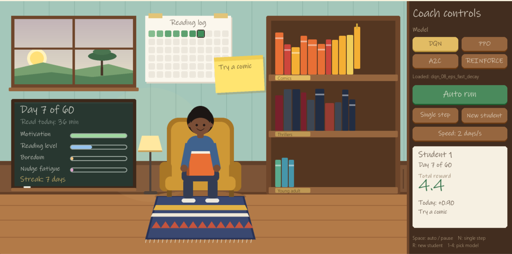

# READit Coach: Reinforcement Learning for Leisure-Reading Engagement

An RL agent that coaches one student's **leisure reading** (comics, thrillers, young adult fiction) over a simulated 60-day period. It is the reinforcement-learning version of my mission: building a reading culture among young people in Africa. Four algorithms (DQN, REINFORCE, A2C, PPO) are trained with **TorchRL** on the same custom Gymnasium environment and compared.



## Why this needs RL

Each day the agent picks one action, and that action changes the student's state for later days. Stretch books give a short-term motivation cost but a long-term reading-level gain; repeating a genre builds boredom; too many nudges cause fatigue. The best action today depends on its delayed effects, and there is no labeled "correct" action to learn from, so this is a sequential decision problem, not a one-shot recommendation or ranking task.

## Environment (`environment/custom_env.py`)

**Actions (Discrete 9):** 0-2 recommend a comic / thriller / young adult book at the student's level; 3-5 recommend the same genres as a harder "stretch" book; 6 peer nudge; 7 badge/streak challenge; 8 rest.

**Observation (12 values, all in [0, 1]; 1 step = 1 simulated day):**

| # | Name | Meaning | Simulation rule (updated each day) | Real-app source |
|---|------|---------|-------------------------------------|-----------------|
| 0 | reading_level | Reading ability | Grows after finished stretch books | Reading-level classifier / placement quiz |
| 1-3 | interest_comic / thriller / ya | Appeal of each genre | Rises when that genre is recommended, drifts down otherwise | Reading history and ratings |
| 4 | motivation | Willingness to read | Up for well-matched books, badges, nudges; down for hard or repeated books and missed days | Session frequency, reflections |
| 5 | streak | Consecutive reading days (min(streak,30)/30) | +1 if minutes > 5, else reset | App streak counter |
| 6 | boredom | Fatigue from repeated genres | Up on repeat, down on a genre change or rest | Recent genre history |
| 7 | nudge_fatigue | Annoyance from nudges | Up with each nudge, decays daily | Notification count and dismissals |
| 8 | day | day / 60 | +1 per step | Usage day counter |
| 9-11 | last_genre_comic / thriller / ya | One-hot of the last recommended genre (0 before the first book) | Set by the previous book action | Reading history |

All values are simulated (no real students yet). Agent input path: `ReadCoachEnv.step()` returns the 12-value array, TorchRL's `GymWrapper` passes it to the network (MLP with two hidden layers of 128), which outputs a score per action.

**Reward:** `minutes_read / 50 + 0.02 * min(streak, 30) + 10 * reading_level_gain`, minus 5 if the student drops out.

**Start state:** a random student profile (level, genre interests, motivation). **Terminal conditions:** day 60 reached, or the student drops out (motivation below 0.05 for 3 days).

**Reference scores** (mean episode reward): random policy about 46, hand-made heuristic about 56.

## Algorithms and experiments

DQN, REINFORCE, A2C and PPO all train for the same 30,000 frames on the same environment and are evaluated greedily on the same 20 unseen episodes. Each algorithm has at least 10 hyperparameter runs:

- **DQN (12 runs):** learning rate, discount factor, batch size, replay buffer size, epsilon decay speed and floor, soft target update rate, network size.
- **REINFORCE (11 runs):** learning rate, discount, return normalization, entropy bonus, rollout length, network size.
- **A2C (12 runs):** learning rate, discount, GAE lambda, entropy bonus, critic coefficient, rollout length.
- **PPO (12 runs):** learning rate, clip range, epochs per batch, GAE lambda, entropy bonus, rollout length, minibatch size.

Full results: `assets/all_runs_table.csv`; per-run logs: `logs/`.

| Algorithm | Runs | Best run (evaluation) | Best eval | Median eval | Worst eval | Runs reaching reward 65 | Median frames to reach 65 |
|---|---|---|---|---|---|---|---|
| DQN | 12 | dqn_08_eps_fast_decay | 74.2 | 73.0 | 70.2 | 12/12 | 8,400 |
| REINFORCE | 11 | reinforce_05_gamma_0.999 | 72.7 | 71.2 | 38.8 | 6/11 | 14,340 |
| A2C | 12 | a2c_11_rollout_120 | 72.8 | 71.8 | 70.1 | 7/12 | 15,360 |
| PPO | 12 | ppo_10_entropy_0.05 | 74.1 | 73.3 | 65.4 | 12/12 | 11,500 |

Figures: `assets/fig1_reward_baselines.png`, `fig2_reward_best.png`, `fig3_dqn_loss.png`, `fig4_pg_entropy.png`, `fig5_convergence.png`, `fig6_evaluation.png`.

## Key findings

- All four algorithms reach similar final quality (best evaluations 72.7 to 74.2, within run-to-run noise of about 2 to 3 points), far above random and the heuristic.
- They differ in sample efficiency and stability: DQN learns fastest per frame and every run converged; PPO is the most reliable policy-gradient method; REINFORCE is the most sensitive (learning rate 1e-2, no return normalization, a very short rollout and a small network failed).
- Training reward (sampled actions) is lower than evaluation reward (greedy actions) for slow-learning runs, because the greedy action is often already good while the policy is still close to random.
- Learned behavior: no student dropped out in 5 test episodes per agent. DQN rotates genres and adapts its mix to each student; PPO alternates comics with young adult books and adds 1 to 2 badge challenges.

## How to run

```bash
uv sync
uv run main.py                              # opens the room + control panel, agent starts playing
uv run main.py --algo ppo                   # same, starting with the PPO agent
uv run main.py --classic --verbose          # plain window, daily decisions in the terminal
uv run main.py --no-render --episodes 5     # terminal only, no window
uv run main.py --api-demo                   # JSON in / JSON out example
```

Options: `--algo {dqn,reinforce,a2c,ppo}`, `--run <run name>`, `--episodes N`, `--seed S`.

Retrain and re-plot:

```bash
uv run python training/dqn_training.py all
uv run python training/pg_training.py all
uv run python training/make_plots.py
```

## Integration path

`predict_json` in `main.py` takes a student's state as JSON and returns the recommended action as JSON, so a web or mobile backend could call the trained model per student (`uv run main.py --api-demo` shows an example).

## Project structure

```
main.py                  run a trained agent
environment/             custom_env.py (Gymnasium env), rendering.py (pygame)
training/                dqn_training.py, pg_training.py, make_plots.py
models/dqn, models/pg    trained weights
logs/                    per-run reward, loss/entropy and summary files
assets/                  figures and environment screenshot
tests/                   environment and baseline checks
```

## Limitations

- The student is simulated: transition rules are my design, not fitted to real reading data.
- Each configuration used a single seed, and evaluation differences between the best runs are within noise.
- The agents rarely use peer nudges or rest, because in this simulation they cost more than they gain. A richer simulation would make those actions matter.